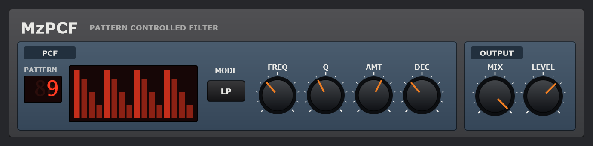

# MzPCF

**ReBirth's pattern-controlled filter, for any track in your DAW.** MzPCF is a VST3 effect
that emulates the PCF from Propellerhead's ReBirth RB-338: a resonant filter played by one of
32 step patterns, struck on every sixteenth of your project and closing again in between, so
it plays a rhythm of its own over whatever goes through it. Pumping pads, gated chords,
wah-wah basslines and drum loops that breathe.

It is the PCF in [MzDebirth](https://github.com/simozzer/MzDebirth)'s effects rack, too: the
rack compiles its PCF from this repository, so the two are one and the same, and a pattern
number means the same in both.

The controls, as on ReBirth's panel:
- **PATTERN** - which of the 32 patterns plays the filter. Drag the number up or down, or
  use the wheel; the display draws the pattern and lights the step playing.
- **FREQ** - where the filter rests between strikes, 40 Hz to 10 kHz.
- **Q** - resonance, from gentle to a whistle as the pattern sweeps it.
- **AMT** - how far a full-level step opens the filter above FREQ, up to seven octaves.
- **DEC** - how fast it closes again, 15 ms to 1.5 s.
- **MODE** - low-pass, or band-pass for a thinner, wah-like sweep.

And two that ReBirth didn't need, for use as an insert:
- **MIX** - dry to fully filtered, for blending the effect in.
- **LEVEL** - -24 to +12 dB, to make up what the filter takes away.

The pattern follows your DAW's transport, to the sample: step 1 is the first sixteenth of
every bar, and it follows loops and tempo changes. With the transport stopped nothing is
struck, and the filter settles back to FREQ - as ReBirth's PCF did when ReBirth stopped.

MzPCF is an independent project. ReBirth is a trademark of Reason Studios.

## Installing

Download `MzPCF-<version>-win64-Setup.exe` from the
[releases page](https://github.com/simozzer/MzPCF/releases) and run it. It asks whether to
install for everyone or just you:

- **Everyone** (needs administrator rights) puts the VST3 in
  `C:\Program Files\Common Files\VST3`, which every DAW scans.
- **Just me** puts it in `%LOCALAPPDATA%\Programs\Common\VST3`. Some DAWs need that folder
  added to their plugin paths once; in Ableton Live it goes under
  *Preferences → Plug-Ins → VST3 Plug-In Custom Folder*.

Then rescan plugins in your DAW. The installer isn't code-signed, so Windows may warn about an
unknown publisher: choose *More info → Run anyway*. Uninstall from *Settings → Apps*.

To build it yourself instead, see [Building](#building).

## Building

Needs Visual Studio 2022+ with *Desktop development with C++*, and JUCE checked out beside
this repository (`..\JUCE`, or pass `-DJUCE_PATH=`).

    .\build.ps1                 engine check, then the VST3
    .\build.ps1 -NoPlugin       engine check only
    .\build.ps1 -Wav out        and render demo phrases into out\ to listen to
    .\build.ps1 -Release        and the release downloads into dist\: Setup.exe and a zip

`-Release` needs [Inno Setup 6](https://jrsoftware.org/isdl.php). The installer's script is
`installer\MzPCF.iss`, and it takes its version from `CMakeLists.txt`.

## Releasing

GitHub builds the downloads for every release and attaches them, so each one has its
installer:

1. Bump the version in `CMakeLists.txt`.
2. Write the notes in `docs/releases/v<version>.md`, ending with the copyright line
   (copy it from the last release's notes), then commit both.
3. Tag and push: `git tag -a v0.2.0 -m "MzPCF 0.2.0"`, then `git push origin main v0.2.0`.
4. The *release* workflow builds and checks the plugin, then makes a **draft** release with
   the notes and the two downloads. Read it over on GitHub and publish it.

The workflow stops if the tag and the version in `CMakeLists.txt` disagree. To rebuild an
existing release's downloads, run the workflow from the *Actions* tab with that tag.

## Layout

    Source/PCF/          the effect - plain C++, no JUCE
      Pcf.h/.cpp         the patterns, the envelope and the filter - which MzDebirth's rack
                         plays on its own clock - and the host clock that plays them here
      Settings.h         the front panel, in panel units
    Source/              the JUCE plugin round it: parameters, look, editor
    Tests/PcfCheck.cpp   the engine's checks; gates the plugin build

## How it works

ReBirth's manual describes the PCF as a two-pole filter, low-pass or band-pass, with cutoff
and resonance; an envelope whose decay is set on the panel, whose attack comes from the
pattern, and whose depth is set by AMT; and preset patterns for pumping, sweeps and phrasing.
Beyond that, the curves and ranges here are chosen by ear rather than measured from ReBirth,
and the 32 patterns are MzDebirth's, not a transcription of ReBirth's.

**The clock.** At the top of every block the plugin reads where the host's timeline is, and
runs it forward sample by sample from there. A strike lands on the first sample of each
sixteenth. Playback started in the middle of a step waits for the next one, as a step
sequencer would; a loop back to the bar strikes step 1 where it lands. In a pre-roll, the
steps count in to step 1 on the bar.

**The envelope.** Each strike sets the envelope to that step's level - a step at 0 closes the
filter - and it decays exponentially by DEC. A third of a millisecond's rounding on the strike
keeps it from clicking.

**The filter.** A trapezoidal (zero-delay feedback) state-variable filter, after Zavalishin,
which stays in tune and stable however fast the pattern moves its cutoff. The cutoff is
FREQ raised by AMT × the envelope, in octaves, up to 45% of the sample rate. Band-pass is
scaled to the same level at its centre whatever the Q. Every knob is smoothed over 10 ms, so
automating one doesn't zip.

## Licence

Copyright (C) 2026 Simon Moscrop. Free software under the GNU AGPL v3; see [LICENSE](LICENSE).
